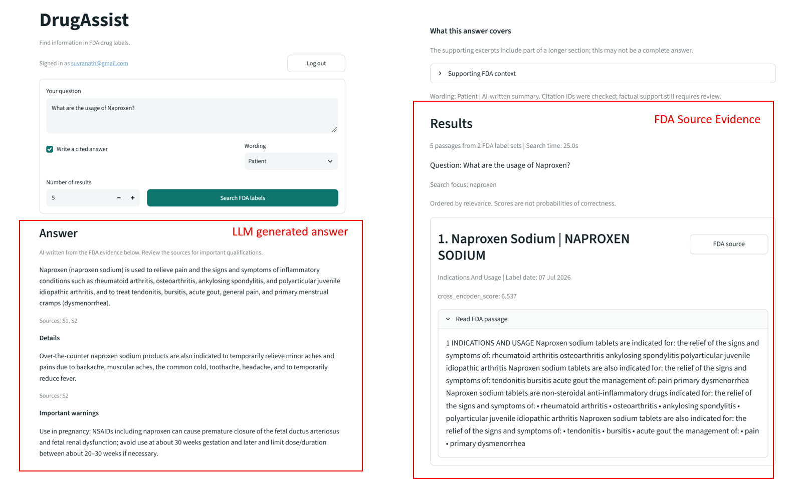

# DrugAssist

Retrieve FDA drug-label evidence and generate optional, source-cited answers.

[](https://github.com/suvrazastrovision/DrugAssist/actions/workflows/tests.yml)
[](pyproject.toml)
[](LICENSE)
[](https://doi.org/10.5281/zenodo.23814386)

[Quick start](#quick-start) · [Documentation](#documentation) · [Tests](docs/testing.md) · [Troubleshooting](docs/troubleshooting.md)

## What it does

- **Find evidence:** keyword and semantic retrieval with local reranking.
- **Write cited answers:** optional OpenAI summaries with Patient or Clinician wording.
- **Inspect sources:** label passages, dates and FDA links remain available for review.

The prepared collection contains **60 drug names · 118 FDA labels · 8,601 passages**.
This is a bounded corpus, not the full openFDA dataset.

**Stack:** Streamlit · FastAPI · ChromaDB · OpenAI · openFDA



[More screenshots](docs/app-frontend-overview.md) · [How it works](docs/app-flow.md)

## Quick start

Requires [Git](https://git-scm.com/downloads), [uv](https://docs.astral.sh/uv/getting-started/installation/)
and an OpenAI API key. First setup needs internet; new semantic searches, answers and source-build
embeddings can incur API charges. Use a local folder outside OneDrive or other sync services.

### 1. Install

```sh
git clone https://github.com/suvrazastrovision/DrugAssist.git DrugAssist
cd DrugAssist
uv sync --locked --inexact --python 3.11
```

### 2. Set up and launch

**Windows x64 + Python 3.11:**

```powershell
powershell -ExecutionPolicy Bypass -File .\start.ps1
```

The launcher prompts for your key, saves it in the ignored `.env`, prepares the data and opens
the app. The prepared ZIP requires a compatible [data release](https://github.com/suvrazastrovision/DrugAssist/releases/tag/data-v0.1.0).
To build from source instead, use:

```powershell
powershell -ExecutionPolicy Bypass -File .\start.ps1 -FromSource
```

**macOS/Linux, Python 3.12 or manual startup:** follow the [setup guide](docs/setup.md#3-set-up-and-launch)
to configure `.env`, build the data and start both servers. Cloning alone does not include searchable data.

### 3. Ask and verify

Open [DrugAssist](http://127.0.0.1:8501), sign up and log in. Ask **“What warnings are listed for warfarin?”**
and check the supporting passages. Uncheck **Write a cited answer** for evidence only.

Keep the terminal open; press **Ctrl+C** to stop. Rerun the launcher to reopen the app.
See [usage and settings](docs/usage.md) for accounts, manual startup and the API.

## Documentation

| Guide | Contents |
|---|---|
| [Setup](docs/setup.md) | Tool installation, platform requirements and startup |
| [Usage](docs/usage.md) | Accounts, answers, settings, API and terminal search |
| [Optional observability](docs/observability.md) | Metadata-only Langfuse tracing and verification |
| [Tests](docs/testing.md) | Offline checks, CI and manual online validation |
| [Troubleshooting](docs/troubleshooting.md) | Installation, data, ports, provider and tracing issues |
| [App flow](docs/app-flow.md) | Data preparation and retrieval pipeline |
| [Database schema](docs/database-schema.md) | Labels, caches and accounts |
| [App autograding](docs/evaluation.md) | Source-pinned cases, optional judging and regression reports |
| [Research](docs/research.md) | Notebooks, evaluation and maintenance |
| [Repository and data](docs/repository.md) | Storage layout, data transfer and release publishing |
| [Configuration](config/default.json) / [Environment](.env.example) | Drug list, models and private settings |
| [Benchmark notebook](notebooks/03_retrieval_pipeline_benchmark.ipynb) | Six methods; 60 baseline and 10 hard questions |

> For information, not personalized medical advice. Verify generated answers against the cited labels.
> Relevance scores are not confidence estimates; benchmarks do not establish clinical correctness.

## License and credits

[MIT License](LICENSE). Third-party dependencies, model weights and datasets retain their own terms.

Designed and developed by **Suvra Nath**, supervised by **Ofer Feder**, for the **DevOps and AI Engineering**
qualifying certification examination at **MSIT Masterschool**.
