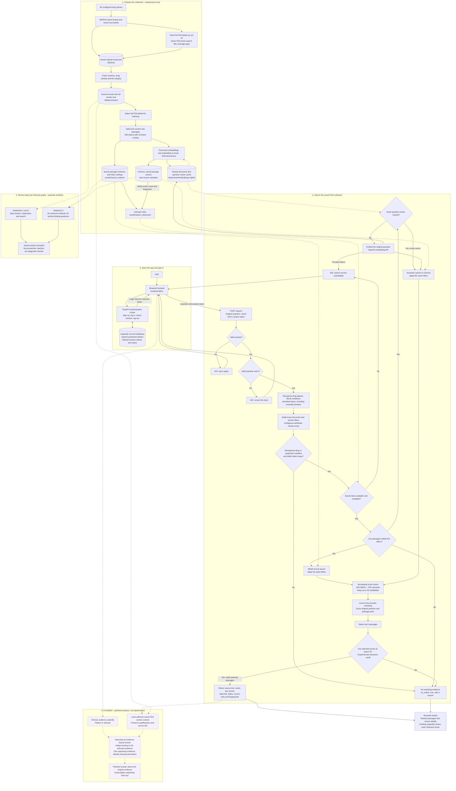

# DrugAssist

This project finds passages in FDA drug labels. It returns source text and links; it does not generate medical advice.

The active collection covers **60 manually chosen drug names**, **118 full FDA labels**, and **8,601 searchable passages**. It is a sample, not every FDA drug. Drug names are listed in `config/default.json`.

## App flow diagram

Solid arrows show processing; dotted arrows also connect saved data to the steps that read it. Purple dashed boxes mark the proposed answer-generation layer, which is not running yet. Data preparation happens during maintenance, rather than on every question.



The original question reaches lexical search, semantic search and reranking without the parser rewriting its meaning. The API filters by recognized drug and section; it does not interpret manufacturer, route, version or date constraints in natural language. Conditions are not database filters. Terminal search uses the shared retrievers with explicit command-line filters and bypasses the app's login, parser, scope gate and relevance cutoff.

Each current result is a passage from a longer section, so it can end mid-list. The complete section remains in the saved dataset. Expanding a passage currently shows that chunk only. Loading complete supporting sections and generating a polished answer are proposed changes. The existing 80-question draft benchmark remains separate and needs independent review before accuracy claims; generated answers would also need their own factual and citation checks.

## Read the notebooks

Open them in order and run their cells from top to bottom. They use saved local files without API calls.

Install notebook tools with `uv sync --locked --extra research`, then select the Python interpreter in `.venv`.

| Notebook | Main question | Data used |
|---|---|---|
| [1. Data quality](notebooks/01_data_quality_analysis.ipynb) | Are the downloaded files usable, and what is missing? | Current 60-drug collection |
| [2. Explore and search](notebooks/02_exploratory_data_analysis.ipynb) | How do labels become passages, and how can I search them? | Current 60-drug collection |
| [3. Compare search methods](notebooks/03_retrieval_pipeline_benchmark.ipynb) | How often did each method find the requested section? | Current 60-drug collection / 60 simple questions |

Notebook 3 compares all six methods using one direct section-finding question per drug: 20 about uses, 20 about dosage instructions and 20 about warnings. Expected matches come from FDA identity and section fields. Finding an expected section does not prove that a passage answers a medical question. This automatic check is separate from the original 80-question draft benchmark, which still needs independent human review.

## Set up and search

Use Python 3.11 or 3.12 and [uv](https://docs.astral.sh/uv/).

```powershell
uv sync --locked

# Word-based search; no embedding API call.
uv run --locked fda-rag search "Find apixaban ingredient information" --method bm25 --k 3

# Interactive search using the selected hybrid method.
uv run --locked fda-rag search
```

Keep `OPENAI_API_KEY` in the ignored `.env` file. Semantic and hybrid searches use it to embed new questions; cached embeddings are reused. BM25 and keyword search work without it. The default hybrid reranking search also uses a downloaded local reranker.

Methods: `keyword`, `bm25`, `dense` (semantic), `hybrid_rrf`, `hybrid_normalized`, and `hybrid_rerank`. API and terminal searches default to **`hybrid_rerank`**, configured by `api.method`. `--method selected` reuses the original saved development selection; an explicit `--run` also preserves its saved selection unless a method is specified. Scores rank passages; they are not probabilities that an answer is correct.

Use `--section warnings`, `--set-id <label-set-id>`, or `--document-id <document-id>` to narrow results. Filters use exact matches and are combined. Add `--json` for structured output. Type `/quit` to leave interactive search.

## Run DrugAssist

Install the app with `uv sync --locked` while the app servers and notebook executions are stopped. Then start the backend and frontend in two terminals. `--no-sync` reuses the installed environment and avoids changing files that a running process has loaded:

```powershell
# Terminal 1 - backend
uv run --locked --no-sync uvicorn src.api.main:app --host 127.0.0.1 --port 8000

# Terminal 2 - frontend
uv run --locked --no-sync streamlit run frontend/app.py
```

Open **http://localhost:8501**, choose **Sign up**, then **Log in**. Enter a drug-label question, choose the number of results, and search. While searching, a status panel shows that the request is in progress. Results show passage and label-set counts, request time, readable label dates and raw relevance scores. The top passage opens first; other passages and detailed source identifiers can be expanded. Every result retains its FDA source link. Use **Log out** to revoke the current session.

The frontend calls FastAPI; it does not access Chroma or run retrieval itself. `DRUGASSIST_API_URL` and `DRUGASSIST_REQUEST_TIMEOUT` in `.env` configure the connection (defaults: `http://127.0.0.1:8000` and 120 seconds). Remote API URLs must use HTTPS. Both servers bind to localhost by default.

The API reference is at **http://127.0.0.1:8000/docs**.

| Endpoint | Access | Purpose |
|---|---|---|
| `POST /auth/signup` | Public | Create an account |
| `POST /auth/login` | Public | Receive a 60-minute session |
| `GET /auth/me` | Logged in | Check the session and current user |
| `POST /auth/logout` | Logged in | Revoke this session |
| `POST /search` | Logged in | Search FDA evidence |
| `GET /health` | Public | Check the search index |

To call the API directly, send the login response's `session_token` in an `Authorization: Bearer <session_token>` header. Signup and login both accept `email` and `password`. Signup returns **201**, duplicate emails **409**, invalid input **422**, rejected sessions **401**, and successful logout **204**. A no-match search remains **200**.

Accounts are stored separately in the ignored `data/auth/users.sqlite3` database; `DRUGASSIST_AUTH_DB` can override its path. Emails are trimmed and normalized; passwords must contain 8 to 128 characters and are stored as Argon2 hashes. Only SHA-256 hashes of random session tokens are stored in SQLite. Expiration is checked on every protected request. Login also removes expired rows; `AuthService.cleanup_expired()` is available for explicit cleanup.

Streamlit keeps the raw token only in its server-side session state, rechecks `/auth/me` on every rerun, and clears the state on logout or a rejected session. A full browser refresh may require logging in again. Password fields clear after submission.

**Local MVP:** signup and login share a limit of 10 attempts per client IP in 10 minutes. The limiter is in memory, resets when the backend restarts, and requires one backend worker. Keep this local until HTTPS, rate limiting and account management have been reviewed for public deployment. Email verification, password reset and account recovery are outside this MVP.

`GET /health` checks the saved Chroma collection and returns its document/chunk counts. `POST /search` accepts a nonblank query of up to 2,000 characters and an optional integer `k` from 1 to 20 (default 5). Responses include parsed attributes, applied filters, ranked source text, label IDs, source fingerprints, scores, a medical disclaimer and `no_match`.

The API uses **hybrid retrieval followed by cross-encoder reranking** (`hybrid_rerank`). The existing 25% BM25 / 75% semantic fusion retrieves up to 30 candidates, then the pinned `cross-encoder/ms-marco-MiniLM-L6-v2` scores each question/passage pair and returns the top `k` matches. The same saved embeddings and Chroma collection are reused. Reranking runs locally on CPU and takes longer than fusion alone.

Exact names come from FDA identity fields; ambiguous names or information types stay `null`. Known drugs can cover several label documents. Conditions use a small literal vocabulary and are never applied as database filters. Unknown or non-label topics can return `no_match: true`; reliable filters are never relaxed.

The parser also recognizes everyday topic wording: "What is metformin for?" selects uses, "How should metformin be taken?" selects dosage, and "What unwanted effects can metformin cause?" selects adverse reactions. It uses a small phrase dictionary and verified drug aliases. The original question, including negation and quantities, still goes to retrieval and reranking unchanged. This routes questions to label sections; it does not infer medical answers or silently correct drug names.

**Rejection is experimental.** `api.min_score` in `config/default.json` defaults to `0.5` for `api.threshold_method = hybrid_rerank`. This cutoff applies to the final cross-encoder score, not the hybrid fusion score, and must match `api.method`. The pinned model returns raw relevance scores that can be negative or exceed 1; `0.5` does not mean 50% confidence. The cutoff has not been calibrated on the expanded collection. The response identifies the score as `cross_encoder_score` and reports the threshold's experimental status; positive results still require source review.

Document and query embeddings share `data/cache/embeddings.sqlite3`, keyed by the model's fingerprint and exact text. Search reuses the saved vectors through one cache layer. The saved provider and embedding space are reused, including local models when configured. Cached queries can work during a provider outage. Uncached provider failures or unavailable databases return **503**, invalid requests return **422**, and valid requests without matches return **200** with `no_match: true`.

The search API reads the existing index; it does not ingest records or generate answers. `create_app(service_factory=..., auth_factory=...)` provides dependency injection. Retrieval tests use temporary Chroma collections; authentication tests use temporary SQLite databases; Streamlit tests call the real auth routes with mocked retrieval. Tests disable external HTTP and `.env` loading. Install test and research tools with `uv sync --locked --extra research --extra dev`, then run `uv run --locked --extra research --extra dev pytest -q`.

## Files worth knowing

| Location | Purpose |
|---|---|
| `notebooks/` | The reviewer-facing explanation and results |
| `src/` | Shared retrieval, evaluation, API and authentication code |
| `frontend/app.py` | Minimal Streamlit signup, login and search screens |
| `src/auth/` | Separate account database and session authentication |
| `config/default.json` | Drug names, models and search settings |
| `data/raw/` and `data/processed/` | Original downloads and saved datasets |
| `data/cache/`, `data/chroma/`, `data/models/` | Cached embeddings, search index and local models |
| `data/benchmarks/benchmark.json` | Original test questions and draft source evidence |
| `results/search_latest.json` | Pointer to the active 60-drug index |
| `results/latest.json` | Pointer to the original saved comparison |
| `reports/data_checks.json` | Dataset ID, drug coverage, data quality, file integrity and name-search checks |
| `reports/expanded_60/method_comparison.json` | Saved questions, source references and results used by notebook 3 |
| `reports/api_contract.json` | Recorded external data API capabilities |
| `tests/` | Checks that the implementation behaves as intended |

Recent summaries and name-lookup records come from MORVS. Full records come from FDA and supply the searchable text. Some MORVS text is shortened. Source files and fingerprints are retained so results can be checked. An FDA label record does not by itself establish product approval or medical accuracy.

Large local datasets, models and indexes are ignored by Git. To reproduce the saved results on another computer, transfer those files as well as the repository. Fresh downloads can differ from the saved versions.

The API runs without `reports/`. Notebook 3 reads the saved method comparison; the maintenance command uses `data_checks.json` as an acquisition checkpoint and can fall back to the active saved dataset when it is absent. The reports support review and reproducibility. Keep the source data, settings, benchmark evidence and saved experiment results as well.

## Maintain and check the project

```powershell
# Check all configured drug names offline. This is also the default maintenance step.
uv run --locked fda-rag maintain

# Fetch missing labels, build the index, then check it. Indexing can use the embedding API.
uv run --locked fda-rag maintain --step all

# Individual steps are available with --step acquire, index or verify.

# Run or resume the six-method comparison used by notebook 3.
uv run --locked --extra research python scripts/compare_search_methods.py

# Execute all three notebooks using this project's Python environment.
uv run --locked --extra research python scripts/execute_notebooks.py

# Run implementation checks.
uv run --locked --extra research --extra dev pytest -q
uv run --locked --extra research --extra dev ruff check src tests scripts frontend
```

Acquisition reuses existing matching labels; a direct FDA name search fills gaps left by MORVS. New indexing can incur embedding API usage. The original benchmark remains separate from the expanded search index.

Notebook execution and the full `benchmark` command require `--extra research`.

The first comparison run also embeds its new questions and runs the local reranker. Later notebook runs read the saved results without API calls. The separate local embedding comparison model is optional and downloads only when explicitly requested with `benchmark --compare-embeddings`; the saved results remain available without that download.

For independent relevance review, see [ANNOTATION_PROTOCOL.md](ANNOTATION_PROTOCOL.md). Detailed metrics, configuration and source archives remain beside the original saved experiment. Keep these when sharing claims about its results.

Draft review exports are optional. Generate them only when needed with `uv run --locked python scripts/export_annotation_review.py`; the questions and draft evidence remain in `data/benchmarks/benchmark.json`.
