# Application flow

[README](../README.md) | [Run and search](usage.md) | [App flow](app-flow.md) | [Research](research.md) | [Repository guide](repository.md)

## Workflow at a glance

1. **Maintenance:** download, validate, split, embed and index FDA labels.
2. **App:** log in → filter → hybrid retrieval → rerank → optional cited answer.
3. **Research:** inspect data and compare retrieval separately.

## Detailed diagram

- **Solid arrows:** processing. **Dotted arrows:** saved-data connections.

```mermaid
flowchart TB
    subgraph setup["1. Prepare the collection - maintenance only"]
        Names["60 configured drug names"] --> Discovery["MORVS name lookup and recent summaries"]
        Discovery --> FDA["Fetch full FDA labels by set ID<br/>Direct FDA name search fills coverage gaps"]
        Discovery --> Raw[("Saved original responses<br/>data/raw")]
        FDA --> Raw
        Raw --> Checks["Check schema, drug identity and file integrity"]
        Checks --> Snapshot[("Saved records and full section text<br/>data/processed")]
        Snapshot --> Full["Select full FDA labels for indexing"]
        Full --> Chunks["Split each section into passages<br/>256 tokens with 32-token overlap"]
        Chunks --> DocVectors["Document embeddings<br/>text-embedding-3-small, 1536 dimensions"]
        Cache[("Shared document and question vector cache<br/>data/cache/embeddings.sqlite3")] -.-> DocVectors
        DocVectors --> Cache
        DocVectors --> Chroma[("Chroma: saved passage vectors<br/>and source metadata")]
        Chunks --> Index[("Saved passage inventory and index settings<br/>results/search_indexes")]
        Index --> Pointer["Activate index<br/>results/search_latest.json"]
        Chroma -->|"Verify vector count and fingerprint"| Pointer
    end

    subgraph access["2. Open the app and sign in"]
        User["User"] --> UI["Streamlit frontend<br/>localhost:8501"]
        UI --> Auth["FastAPI authentication routes<br/>Sign up, log in, check session, log out"]
        Auth <--> Accounts[("Separate account database<br/>Argon2 password hashes<br/>Hashed session tokens and expiry")]
        Auth -->|"Login returns a session token"| UI
    end

    subgraph search["3. Search the saved FDA collection"]
        Request["POST /search or /answer<br/>Original question, k, bearer token<br/>Answer requests also select patient or clinician wording"]
        Request --> Session{"Valid session?"}
        Session -->|"No"| Unauthorized["401: log in again"]
        Session -->|"Yes"| Input{"Valid question and k?"}
        Input -->|"No"| Invalid["422: correct the input"]
        Input -->|"Yes"| Parse["Recognize drug aliases, literal conditions<br/>and label topics, including everyday phrases"]
        Parse --> Filters["Build exact document and section filters<br/>Ambiguous attributes remain unset"]
        Filters --> Scope{"Recognized drug or supported condition<br/>and within label scope?"}
        Scope -->|"No"| NoMatch["No matching evidence<br/>no_match: true, with a reason"]
        Scope -->|"Yes"| Ready{"Saved index available and complete?"}
        Ready -->|"No"| Unavailable["503: search service unavailable"]
        Ready -->|"Yes"| Eligible{"Any passages satisfy the filters?"}
        Eligible -->|"No"| NoMatch
        Eligible -->|"Yes"| BM25["BM25 lexical search<br/>Apply the same filters"]
        Eligible -->|"Yes"| Cached{"Exact question vector cached?"}
        Cached -->|"Yes: reuse vector"| Dense["Semantic search in Chroma<br/>Apply the same filters"]
        Cached -->|"No"| QueryVector["Embed the original question<br/>OpenAI embedding API"]
        QueryVector --> Cache
        QueryVector --> Dense
        QueryVector -->|"Provider failure"| Unavailable
        BM25 --> Fusion["Normalized score fusion<br/>25% BM25 + 75% semantic<br/>Keep up to 30 candidates"]
        Dense --> Fusion
        Fusion --> Rerank["Local cross-encoder reranking<br/>Score original question and passage pairs"]
        Rerank --> TopK["Select top k passages"]
        TopK --> Cutoff{"Any selected scores at least 0.5?<br/>Experimental relevance cutoff"}
        Cutoff -->|"No"| NoMatch
        Cutoff -->|"Yes: retain passing passages"| Evidence["Return source text, ranks, raw scores,<br/>label IDs, dates, source links and fingerprints"]
    end

    UI -->|"Question and session token"| Request
    Pointer -.-> Ready
    Index -.-> BM25
    Chroma -.-> Dense
    Cache -.-> Cached
    Evidence --> Mode{"Written answer requested?"}
    Mode -->|"No"| Display["Streamlit results<br/>Optional written answer and supporting context<br/>Original ranked passages and source details"]
    NoMatch --> Display
    Unauthorized --> UI
    Invalid --> UI
    Unavailable --> UI

    subgraph evaluation["5. Review data and retrieval quality - separate workflow"]
        Notebooks["Notebooks 1 and 2<br/>Data checks, exploration and search"]
        Compare["Notebook 3<br/>Six retrieval methods, 60 section-finding questions"]
        Results["Saved reports and plots<br/>Source/section matches are diagnostic checks"]
        Notebooks --> Results
        Compare --> Results
    end
    Snapshot -.-> Notebooks
    Index -.-> Compare
    Chroma -.-> Compare

    subgraph writing["4. Write a cited answer - optional"]
        Audience["User selects Patient or Clinician wording"]
        Context["Expand exact saved section context<br/>Merge overlapping excerpts when budgets permit<br/>Up to 4 sources, 1600 tokens each; 6000 tokens total"]
        Generate["One OpenAI Responses request<br/>Configured model and reasoning; structured output<br/>1500 output tokens; 60-second read timeout"]
        Complete{"Complete response with valid structure<br/>and citations to supplied source IDs?"}
        Supported{"Model reports sufficient evidence?"}
        Written["Direct cited answer, optional details and warnings<br/>Specific evidence gaps and supporting FDA context"]
        Fallback["Written answer unavailable<br/>Keep the retrieved passages"]
        Abstain["Evidence insufficient for an answer<br/>Keep the retrieved passages"]
        Mode -->|"Yes"| Context
        Context --> Generate
        Generate --> Complete
        Complete -->|"Yes"| Supported
        Complete -->|"No / refusal / provider failure"| Fallback
        Supported -->|"Yes"| Written
        Supported -->|"No"| Abstain
        Written --> Display
        Fallback --> Display
        Abstain --> Display
    end
    UI --> Audience
    Audience --> Generate
    Snapshot -.-> Context

```

## Important boundaries

- Streamlit communicates through FastAPI, without direct database access.
- The parser preserves questions and filters recognized documents/sections.
- The score cutoff is experimental, not a probability of correctness.
- Scope rules and CLI differences: [usage guide](usage.md#search-behavior).

## Passages and written answers

- Passage expanders show chunks, which can end mid-list.
- Answer mode expands exact saved text; overlapping windows may merge. Long sections remain partial.
- **Supporting FDA context** shows the writer's excerpts.
- No-match skips writing; generation failures preserve passages.
- Format/source checks do not establish factual support; human review is required.

See [answer settings and states](usage.md#cited-answers), [database relationships](database-schema.md) and [evaluation limits](research.md).
