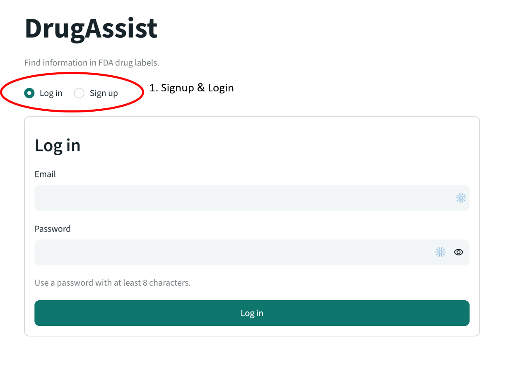
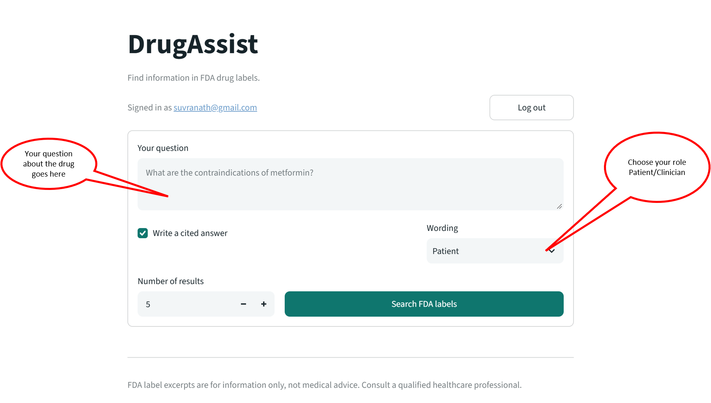
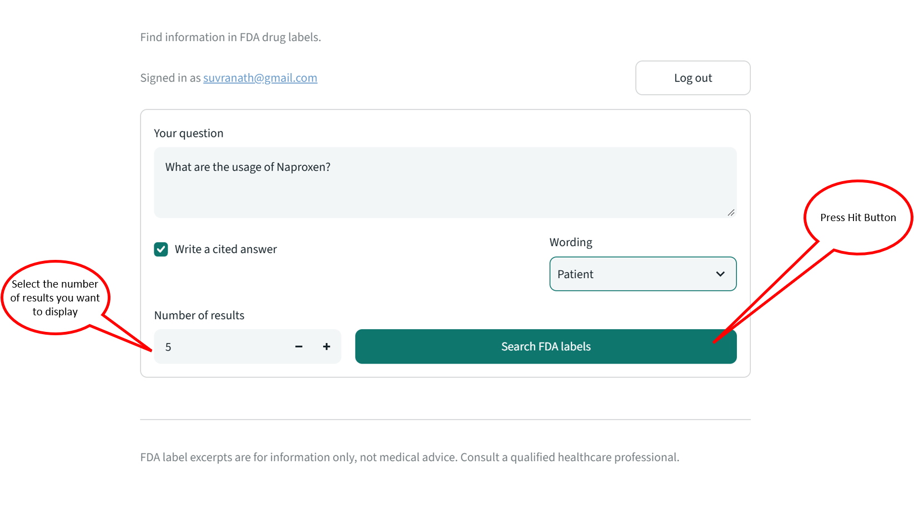
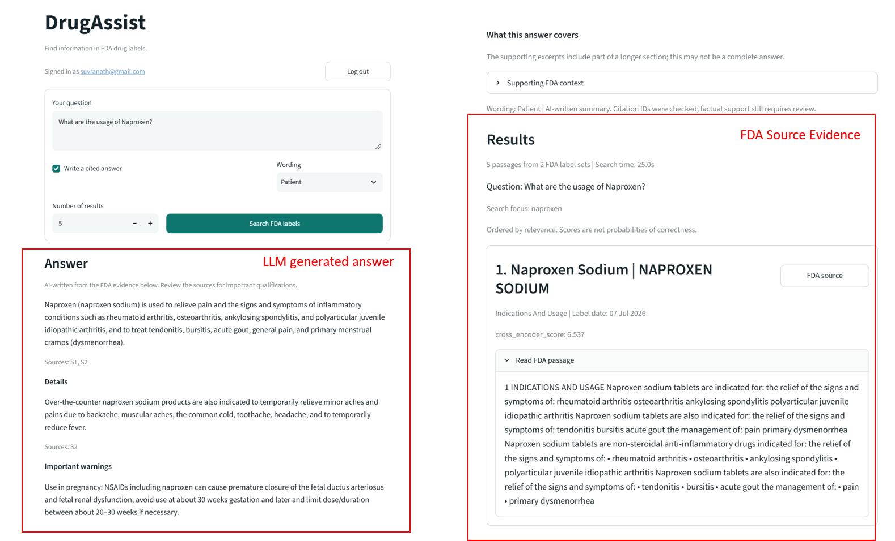

# App frontend overview

[README](../README.md) | [Run and search](usage.md)

## 1. Sign up and log in

Create an account, then log in with your email and password.

## 2. Ask a question

Enter a drug-label question and choose Patient or Clinician wording.

## 3. Search FDA labels

Choose the number of results and select **Search FDA labels**.

## 4. Review the answer and evidence

Read the AI-written answer, then check its citations and original FDA passages.

