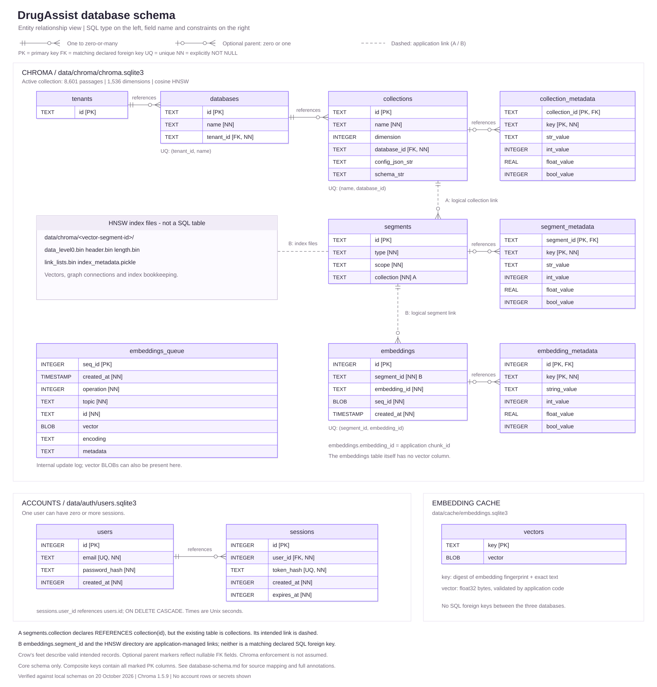
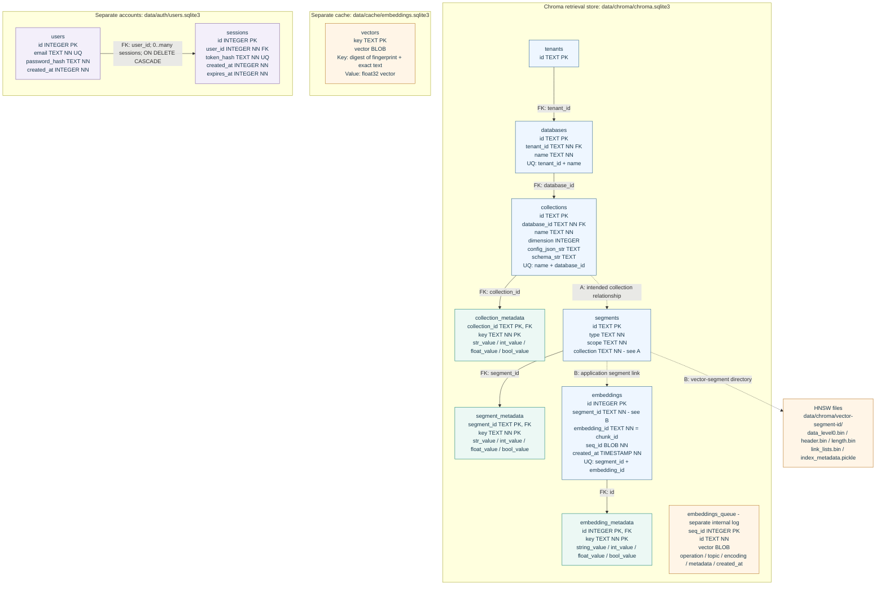

# Database schema

[README](../README.md) | [Repository guide](repository.md) | [Application flow](app-flow.md)

The app uses **three separate local databases**. Chroma stores searchable evidence, an embedding cache avoids repeated encoding, and the account database manages logins. They have no SQL foreign keys between them.

Optional answer writing reuses these stores and the saved FDA sections. It adds no database tables or locally persisted answer history.

[Open the full-size diagram](database-schema.svg).

The image uses a traditional entity relationship style: purple table headers, alternating rows, SQL types in the left column and field names in the right column. Crow's-foot endpoints show relationship cardinality.

## Reading the annotations

| Mark | Meaning |
|---|---|
| `PK` | Primary key; multiple marked columns form a composite key |
| `FK` | A foreign-key declaration pointing to an existing table |
| `UQ` | Uniqueness constraint; a listed pair is unique together |
| `NN` | Explicit `NOT NULL` declaration |
| Double bar (`||`) | Exactly one parent for a valid relationship |
| Circle and bar | Zero or one parent; the foreign-key field permits null |
| Circle and crow's foot | Zero or many child records |
| Solid connector | Relationship backed by a matching foreign-key declaration |
| Dashed connector | Application or storage relationship; not a matching SQL foreign key |

The diagram shows core tables and selected storage details, not every Chroma maintenance table. Cardinalities describe valid intended records; optional parent endpoints reflect nullable foreign-key declarations. Foreign-key declarations describe the schema; they do not establish that every Chroma connection enables SQLite foreign-key enforcement. The index-files callout is a file group, so its dashed connection has no relational cardinality markers.

## 1. Chroma: passage retrieval

**Location:** `data/chroma/chroma.sqlite3`, with generated vector-index files in `data/chroma/<vector-segment-id>/`.

The inspected active collection contains **8,601 chunks**, covering **118 full FDA label sets** and **60 selected drug names**. It uses **1,536-dimensional `text-embedding-3-small` embeddings** and a cosine HNSW index. Other saved collections can use different corpora or embedding dimensions.

| Table or component | What it represents |
|---|---|
| `tenants`, `databases` | Chroma's namespace hierarchy, separate from DrugAssist login accounts |
| `collections` | A named group of records with dimensions and index configuration |
| `collection_metadata` | Typed collection attributes, including corpus and embedding fingerprints |
| `segments` | Internal metadata or vector-storage segments belonging to a collection |
| `segment_metadata` | Typed attributes of a segment |
| `embeddings` | Internal record identifiers, segment membership and update sequence information |
| `embedding_metadata` | Scalar metadata and stored document text associated with a record |
| HNSW segment files | Numerical vector-search index and its generated bookkeeping |
| `embeddings_queue` | Internal update log, which can also contain vector BLOBs and metadata |

**A. Observed schema detail:** `segments.collection` declares `REFERENCES collection(id)` in this installed database, but the existing table is named `collections`. The dashed connection shows the intended application relationship, not a matching declared foreign key. This guide records the observed schema without modifying Chroma internals.

**B. Application-managed links:** `embeddings.segment_id` has no declared SQL foreign key to `segments.id`. A vector segment's ID also identifies its on-disk directory. These are shown as dashed connections.

The `embeddings` table itself has **no vector column**. Vector-search files and the update log hold vector-related data; the separate cache also stores reusable vectors. Treating `embeddings` as a table containing every numerical vector would be inaccurate.

Additional inspected internals include `embedding_metadata_array`, `embedding_fulltext_search` and its FTS shadow tables, `max_seq_id`, `embeddings_queue_config`, `migrations`, `maintenance_log` and `acquire_write`. These are omitted from the image to keep it readable. The array table references `embeddings.id`; it supports array metadata, while the app currently writes scalar chunk attributes. The FTS5 table uses trigram tokenization; the app's BM25 retriever is implemented separately in Python.

### How an FDA passage maps into Chroma

These are fields in the **Chroma record API**, not columns of a fictional `chunks` SQL table:

| Record field | Value written by this app |
|---|---|
| `id` | The deterministic `chunk_id`; internally stored as `embeddings.embedding_id` |
| `embedding` | The numerical vector for `embedding_text` |
| `document` | `identity` + newline + `Section: <section>` + newline + original chunk `text` |
| `metadata` | The 16 scalar chunk attributes listed below |

Metadata keys are `chunk_id`, `document_id`, `snapshot_id`, `set_id`, `section`, `start`, `end`, `token_count`, `kind`, `source_record_hash`, `source_body_sha256`, `effective_time`, `authority_url`, `strategy`, `size` and `overlap`. Chroma stores the document under its internal `chroma:document` metadata key. The separate `text` and `identity` fields remain in the saved chunk JSON; they are not separate metadata keys written by this app.

`start` and `end` are Python character offsets within the original section, with an exclusive end: `section_text[start:end]`. They are not token or byte offsets. `set_id` identifies a label set, `document_id` identifies a normalized document, and `chunk_id` identifies a particular passage and splitting configuration. These identifiers do not all mean "drug ID."

Full normalized section text lives under `data/processed/<snapshot-id>/documents.json`. The passage inventory lives under `results/search_indexes/<index-id>/chunks.json`. `results/search_latest.json` selects the active index descriptor. Links between these files and Chroma are verified by application identifiers and fingerprints, not SQL foreign keys.

## 2. Embedding cache: reuse numerical vectors

**Location:** `data/cache/embeddings.sqlite3`.

Its actual table is `vectors(key TEXT PRIMARY KEY, vector BLOB)`. The key is the SHA-256 digest of the canonical JSON pair `[embedding_fingerprint, exact_input_text]`. The BLOB is a NumPy `float32` vector; application code checks dimensions and finite values when reading or writing it.

Document and question embeddings share this cache. The table does not store separate model, question, drug or chunk-ID columns. A cache key is different from a Chroma record ID, and there is no foreign key between these databases.

## 3. Accounts: users and sessions

**Default location:** `data/auth/users.sqlite3`; `DRUGASSIST_AUTH_DB` can override it.

One user can have zero or more sessions. Every valid session belongs to one user through `sessions.user_id -> users.id`. The app enables foreign keys on its authentication connections, and deleting a user cascades to that user's sessions.

`email` and `token_hash` are individually unique. Passwords are stored as Argon2 hashes; random bearer tokens are stored as SHA-256 hashes. Account `created_at` and session `created_at` / `expires_at` are integer Unix timestamps in seconds. The app also indexes `sessions.user_id` and `sessions.expires_at`.

FDA evidence is not linked to a user by a database foreign key, and the current schema contains no search-history table. No private account values are included in this diagram.

## Mermaid relationship overview

Show the storage relationships as editable Mermaid

This flowchart preserves the logical overview. The SVG above provides the table-grid layout and crow's-foot notation.

## Verification and scope

Checked on **20 October 2026**, against the on-disk schemas for **Chroma 1.5.9**, the active index descriptor, and the application code. Database access used SQLite read-only connections and schema inspection; account rows and secret values were not read. Chroma's internal schema can change with package migrations.

Implementation references: [Chroma adapter](../src/indexing/chroma_store.py), [chunk fields and offsets](../src/preprocessing/chunking.py), [cache schema and serialization](../src/embeddings/cache.py), [authentication schema](../src/auth/database.py), [password and session handling](../src/auth/service.py), and [configuration hashing](../src/utils/config.py).

Source hashes support traceability; vector storage and schema correctness do not establish medical relevance or clinical correctness. For the query pipeline, see the [application flow](app-flow.md).
