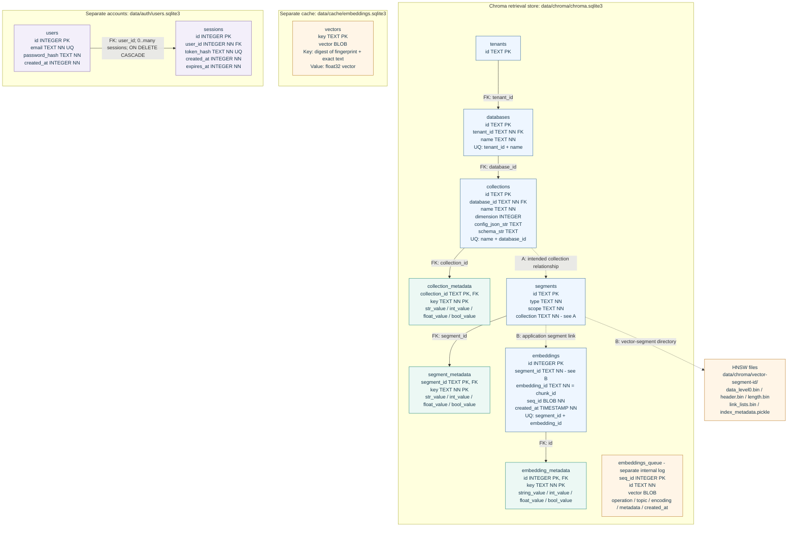

# Database schema

[README](../README.md) | [Run and search](usage.md) | [App flow](app-flow.md) | [Research](research.md) | [Repository guide](repository.md)

## Storage overview

| Store | Purpose | Location |
|---|---|---|
| Chroma | Passage metadata and vector retrieval | `data/chroma/` |
| Embedding cache | Reuse document/question vectors | `data/cache/embeddings.sqlite3` |
| Accounts | Users and login sessions | `data/auth/users.sqlite3` |

- These are separate databases, with **no SQL foreign keys between them**.
- Answer writing reuses saved evidence; it adds no tables or local answer history.


[Open the full-size diagram](database-schema.svg).

## Diagram key

| Mark | Meaning |
|---|---|
| `PK` | Primary key; multiple marked columns form a composite key |
| `FK` | Foreign-key declaration matching an existing table |
| `UQ` | Unique column or column combination |
| `NN` | Explicit `NOT NULL` declaration |
| Double bar | Exactly one parent in a valid relationship |
| Circle and bar | Zero or one parent; nullable foreign key |
| Circle and crow's foot | Zero or many children |
| Solid connector | Matching SQL foreign-key declaration |
| Dashed connector | Application/storage link, not a matching SQL foreign key |

- Core tables only; cardinalities describe valid records.
- Chroma's declared foreign keys do not guarantee enforcement on every connection.
- The vector-file group is not a table and has no cardinality markers.

## Chroma: searchable evidence

- Database: `data/chroma/chroma.sqlite3`.
- Vector files: `data/chroma/<vector-segment-id>/`.
- Active: **8,601 passages, 118 label sets, 60 drug names**.
- Embeddings: `text-embedding-3-small`, 1,536 dimensions; cosine HNSW.
- Historical collections may differ.

| Component | Role |
|---|---|
| `tenants`, `databases` | Chroma namespaces, separate from user accounts |
| `collections`, `collection_metadata` | Named record groups, configuration and fingerprints |
| `segments`, `segment_metadata` | Storage segments and attributes |
| `embeddings` | Record IDs, segment membership and update sequence; **no vector column** |
| `embedding_metadata` | Scalar attributes and stored document text |
| HNSW files | Numerical vector-search index |
| `embeddings_queue` | Internal update log; can contain vector BLOBs |

### Schema details A and B

- **A:** `segments.collection` references `collection(id)`, while the table is named `collections`; intended link shown dashed.
- **B:** `embeddings.segment_id` has no SQL foreign key to `segments.id`; directory links are application-managed.
- Other internals handle arrays, FTS and maintenance. Chroma's trigram FTS is separate from Python BM25.

### Passage mapping

These are **Chroma record API fields**, not a separate SQL `chunks` table.

| Field | App value |
|---|---|
| `id` | Deterministic `chunk_id`; internally `embeddings.embedding_id` |
| `embedding` | Vector for `embedding_text` |
| `document` | Identity + section heading + original passage text |
| `metadata` | The 16 scalar attributes below |

```text
chunk_id, document_id, snapshot_id, set_id, section,
start, end, token_count, kind, source_record_hash,
source_body_sha256, effective_time, authority_url,
strategy, size, overlap
```

- Document text uses `chroma:document`; separate `text`/`identity` fields remain in JSON.
- Offsets: Python characters, `section_text[start:end]`, end exclusive.
- IDs identify label sets (`set_id`), documents (`document_id`) or passages/splitting settings (`chunk_id`).

| Saved file | Role |
|---|---|
| `data/processed/<snapshot-id>/documents.json` | Complete normalized sections |
| `results/search_indexes/<index-id>/chunks.json` | Passage inventory |
| `results/search_latest.json` | Active index pointer |

File/database links use identifiers and fingerprints, not SQL foreign keys.

## Embedding cache

- Table: `vectors(key TEXT PRIMARY KEY, vector BLOB)`.
- Key: SHA-256 of canonical JSON `[embedding_fingerprint, exact_input_text]`.
- Value: `float32` vector; dimensions/finite values checked.
- Shared document/question cache; no separate model, drug or chunk columns.

## Accounts and sessions

- Default: `data/auth/users.sqlite3`; override with `DRUGASSIST_AUTH_DB`.
- `sessions.user_id -> users.id`: one user, many sessions; foreign keys enabled, delete cascades.
- Unique: `email`, `token_hash`. Hashes: Argon2 passwords, SHA-256 session tokens.
- Creation/expiry: Unix seconds; session user ID and expiry indexed.
- No search-history table or user-to-FDA foreign key.

## Editable relationship diagram

<details>
<summary>Show Mermaid source</summary>

The SVG above provides the table-grid layout and crow's-foot notation.



</details>

## Verification and scope

- Schema audit: **20 October 2026**, Chroma **1.5.9**, on-disk schemas and active index.
- Inspection used read-only SQLite connections; no account rows or secrets were read.
- Chroma internals may change after migrations.
- Traceability and correct storage do not establish medical relevance or clinical correctness.

Implementation: [Chroma](../src/indexing/chroma_store.py), [chunk offsets](../src/preprocessing/chunking.py), [cache](../src/embeddings/cache.py), [auth schema](../src/auth/database.py), [sessions](../src/auth/service.py), [fingerprints](../src/utils/config.py).
